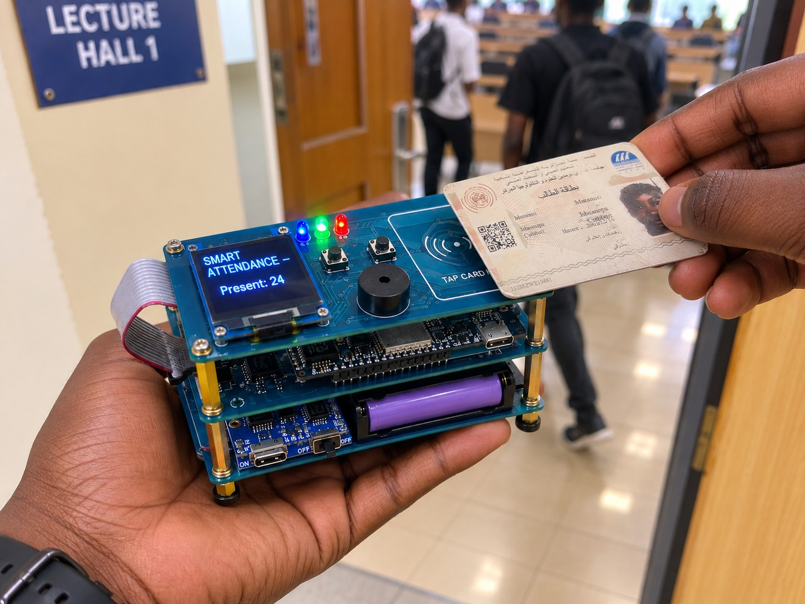
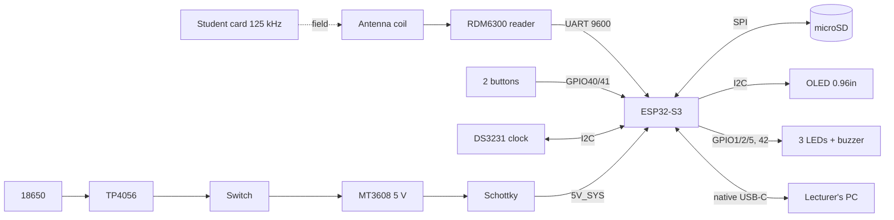

<h1 align="center">Smart Attendance System - by Ice</h1>

<p align="center">
  
  <br>
  <sub><i>Concept image of the finished device (AI-generated illustration). Real photos will replace it after PCB assembly.</i></sub>
</p>

<p align="center">
  <b>Personal embedded-systems project</b><br>
  A battery-powered, cable-free device that records lecture attendance when students tap their existing RFID student card.
</p>

<p align="center">
  <a href="#-about">About</a> &nbsp;·&nbsp;
  <a href="#-how-it-works">How It Works</a> &nbsp;·&nbsp;
  <a href="#-key-features">Features</a> &nbsp;·&nbsp;
  <a href="#-hardware">Hardware</a> &nbsp;·&nbsp;
  <a href="#-pinout">Pinout</a> &nbsp;·&nbsp;
  <a href="#-firmware">Firmware</a> &nbsp;·&nbsp;
  <a href="#-documentation">Documentation</a> &nbsp;·&nbsp;
  <a href="#-repository-structure">Structure</a> &nbsp;·&nbsp;
  <a href="#-roadmap">Roadmap</a>
</p>

---

<h2>📌 About</h2>

Attendance in lecture halls is still often taken on a sheet of paper. That wastes time, invites mistakes and fraud (signing for an absent friend), and the data has to be typed in again afterwards.

Every student already carries a **student card with an RFID chip**, used daily at the student restaurant: you lay it flat on a small reader and the visit is recorded. I built **Smart Attendance System** to bring the same gesture to lectures. At the end of the session the lecturer stands at the door with the device, and each student taps their card on the way out. The device identifies the student, time-stamps the tap, ignores repeated taps and saves everything to a microSD card. Afterwards the lecturer plugs it into a PC, where the card appears as a **USB drive** holding ready-to-use CSV files.

> [!NOTE]
> Status: the prototype, the firmware, the schematics and the three PCBs (routed, Gerber files generated) are done. Manufacturing, assembly and final tests are the next steps.

---

<h2>🔄 How It Works</h2>

1. The lecturer switches the device on (the blue LED blinks twice every 3 s) and presses **button 1** to start a session.
2. Each student lays their card flat on the **TAP CARD** area (125 kHz field).
3. The RDM6300 reader sends the card UID to the ESP32-S3, which checks the frame, looks the UID up in `students.csv`, reads the time from the DS3231 clock and appends a line to the session file.
4. LEDs, buzzer and OLED show the result straight away: **present**, **unknown card**, **duplicate** or **error**.
5. A long press on button 1 ends the session and writes a final list sorted by surname.
6. After the lecture, plugging the native USB-C port into a PC shows the microSD card as a USB drive.

No cable is needed during the lecture: the device runs on an 18650 battery charged over USB-C.

---

<h2>⚡ Key Features</h2>

| | Feature | Detail |
|---|---|---|
| 🧠 | **Controller** | ESP32-S3 N16R8 dev board (16 MB flash, 8 MB PSRAM, native USB) |
| 💳 | **Card reading** | RDM6300, 125 kHz EM4100, card laid flat, 14-byte frame checked by XOR checksum |
| 🕒 | **Time stamps** | DS3231 real-time clock with CR2032 backup |
| 💾 | **Storage** | microSD (FAT32): one CSV per session + a sorted final list per session |
| 🖥️ | **PC access** | USB drive mode (automatic when a PC is plugged in) + serial commands |
| 🔁 | **No duplicates** | A card is counted once per session; a card left on the reader is ignored for 1.5 s |
| 👤 | **Student list** | `students.csv` maps each UID to surname, first names and registration number |
| 🔔 | **Feedback** | 3 LEDs, buzzer (transistor driven), 0.96" OLED |
| 🔋 | **Power** | 18650 cell → TP4056 (USB-C charging + protection) → switch → MT3608 5 V boost |
| 🛠️ | **PCBs** | Three stacked 95 × 60 mm two-layer boards designed in KiCad, joined by two ribbon cables |

---

<h2>💳 Why a 125 kHz Reader?</h2>

The frequency of the student card was not documented. An iPhone (NFC Tools) and an Android phone did not detect the card, while the same Android phone read a passport (13.56 MHz) normally. Phones only read 13.56 MHz, so the card is low frequency (**125 kHz**). The RDM6300 reader then confirmed it.

<h2>🔬 Why ESP32-S3?</h2>

Its **native USB** lets the microSD card appear as a USB drive on the PC with no software to install. It also has enough pins, memory and speed for the reader, clock, card, display and feedback at once. The **dev board is mounted on sockets** instead of designing around the bare chip, which avoids the riskiest part of the board design (antenna, flash, boot circuit).

---

<h2>🏗️ System Architecture</h2>



---

<h2>🔧 Hardware</h2>

The circuit is split over **three stacked 95 × 60 mm boards** to keep the device hand-sized:

| Board | Contents |
|---|---|
| **TOP** | OLED, blue/green/red LEDs, 2 buttons, buzzer + 2N2222A, RFID coil area (no copper) |
| **MIDDLE** | ESP32-S3 on 2 × 22 sockets, RDM6300, Schottky diode, decoupling |
| **BOTTOM** | 18650 holder (underneath), TP4056, slide switch, MT3608, 470 µF, microSD, DS3231 |

Cable 1 joins TOP J1 ↔ MIDDLE J105; cable 2 joins MIDDLE J106 ↔ BOTTOM J201. Both are 16-wire ribbons with the same pin number at both ends.

**Power path:** 18650 → TP4056 → switch → MT3608 (set to **5.0 V with a multimeter before connecting anything**) → Schottky → 5V_SYS (ESP32 5V pin, RDM6300, microSD). 3V3 comes from the ESP32 board regulator (OLED, DS3231, LEDs, buzzer).

> [!WARNING]
> On the protected TP4056, **B− is not ground**: it sits behind the protection transistors. The system ground is **OUT−**. Remove the charging resistor of the DS3231 module: the CR2032 is not rechargeable.

**KiCad projects** (all in `hardware/schematics/kicad/`):

| Project | What it is |
|---|---|
| `sas_complete/` | **The whole system as one circuit**: modules as named-pin blocks, no board connectors (A3) |
| `sas_full_system/` | The three boards and both ribbon cables on one A1 sheet |
| `sas_schematics/` | One sheet per board (hierarchical), shared symbol and footprint libraries |
| `sas_pcb/` | The three routed PCBs, BOM, connector table, power notes, 1:1 printouts |

Gerber and drill files for manufacturing are in `hardware/gerbers/` (one folder per board; zip each folder to upload it). The schematic nets match the routed PCBs (29 nets, identical). Datasheets of every chip and module are in `hardware/datasheets/`.

---

<h2>🔌 Pinout</h2>

| ESP32-S3 GPIO | Connected to | Bus |
|---|---|---|
| 1 / 2 / 5 | Green / red / blue LED (220 Ω) | output |
| 42 | Buzzer transistor base (1 kΩ) | output |
| 40 / 41 | Button 1 (session) / button 2 (info) | input, pull-up |
| 8 / 9 | SCL / SDA: OLED 0x3C, DS3231 0x68 | I2C |
| 10 / 11 / 12 / 13 | microSD CS / SCK / MOSI / MISO | SPI |
| 18 | RDM6300 TX | UART1, 9600 baud |

All pins and options live in [`firmware/include/config.h`](firmware/include/config.h).

---

<h2>🎯 Device Feedback</h2>

| Event | LED | Buzzer |
|---|---|---|
| Start-up OK | green × 3 | 3 beeps |
| Student present | green | 1 short beep |
| Unknown card | red | 1 long beep |
| Duplicate tap | red × 2 | 2 beeps |
| No session running | red × 2 | 2 beeps |
| Session started / ended | green × 3 / red × 2 (long) | 3 beeps / 2 long beeps |
| Error (SD card, clock) | red × 3 | 3 beeps |
| System on | blue: 2 blinks every 3 s | — |

---

<h2>💾 Firmware</h2>

PlatformIO project (Arduino framework) in [`firmware/`](firmware/):

| File | Content |
|---|---|
| `src/main.cpp` | Main program: sessions, card handling, LED/buzzer patterns, OLED, USB drive mode, serial commands |
| `include/config.h` | Every pin, timing and option in one place |
| `include/parsers.h` | Plain C++ helpers (RDM6300 frames, CSV lines, sorting), testable on a PC |
| `test/host/test_parsers.cpp` | 26 unit tests for `parsers.h` (run on the PC) |
| `sketches/D1 … D9` | Step-by-step hardware tests: serial, I2C scan, clock, microSD, reader, LEDs/buzzer/buttons, card read, OLED, clock diagnosis |
| `tools/set_clock.py` | Sets the DS3231 to the PC time over the serial port |
| `data/students.csv` | Template of the student list to copy to the microSD card |

**Files on the microSD card**

| Path | Content |
|---|---|
| `/students.csv` | `UID,Surname,Names,Matricule`, one student per line |
| `/attendance/YYYYMMDD_hhmmss.csv` | One file per session: `uid,surname,names,matricule,date,time,result` |
| `/final/YYYYMMDD_hhmmss.txt` | Final list of the session, sorted by surname, tab-separated (paste into Excel) |

**Build and flash**

```bash
cd firmware
pio run                # build (env: esp32-s3-n16r8)
pio run -t upload      # flash
pio device monitor     # serial monitor, 115200 baud, then type HELP
g++ -std=c++17 -Iinclude test/host/test_parsers.cpp -o t && ./t    # unit tests on the PC
```

<details>
<summary><b>Serial commands</b></summary>
<br>

| Command | Action |
|---|---|
| `HELP` | List the commands |
| `STATUS` | Clock, SD card, students, session |
| `TIME` / `SETTIME YYYY-MM-DD HH:MM:SS` | Show / set the clock |
| `START` / `STOP` | Start or stop a session |
| `LIST`, `DUMP <file>` | List the files / print one |
| `FINAL [file]` | Build and show the sorted final list |
| `STUDENTS`, `RELOAD` | Show / reload the student list |
| `INIT` | Restart the SD card after a problem |
| `MUTE` | Mute or unmute the buzzer |
| `DRIVE` | Show the SD card as a USB drive now |
| `INFO` | Time and count of the last file (same as button 2) |
| `REBOOT` | Restart (also leaves drive mode) |

</details>

<details>
<summary><b>Upload notes</b></summary>
<br>

- Drive mode uses the **native** USB-C port (TinyUSB); serial output goes to the **UART** USB-C port.
- If upload fails with "Unable to verify flash chip connection", hold **BOOT** while it says `Connecting...`.
- On Linux, if the port is not found, add your user to the `dialout` group.

</details>

---

<h2>📚 Documentation</h2>

| Document | Content |
|---|---|
| [`documentation/rapport_final/`](documentation/rapport_final/) | **Project report** in French and English (Word + PDF) |
| [`documentation/poster/`](documentation/poster/) | **Exhibition poster**, two A0 sheets side by side (French) |
| `documentation/Smart_Attendance_Code_Flowcharts.pdf` | Flowcharts of the firmware |
| `documentation/Breadboard_Assembly_Guide_No_Soldering.pdf` | Breadboard prototype guide |
| `documentation/Resume_mini_projet_smart_attendance_system.pdf` | Short project summary (French) |
| `documentation/bill_of_materials.md` | All parts, grouped by function, with board references |
| `documentation/assembly_guide.md` | PCB soldering order, stacking and first power-on |
| `documentation/system_architecture.md` | Blocks, power rails, data flow |
| `documentation/requirements.md`, `decisions_log.md`, `test_plan.md`, `project_plan.md` | Project management documents |
| `documentation/smart_attendance_parts_and_pcb.pdf` | Early shopping list (October 2026, before the card type was known) |
| `simulation/power_budget.md` | Current per part, battery life, charge time (estimates) |
| `hardware/schematics/kicad/sas_pcb/documentation/` | BOM per reference, connector table, power distribution |
| `hardware/datasheets/` | Datasheets of the chips and modules |
| `media/diagrams/` | Block diagram, flowcharts, schematic and PCB images |

---

<h2>🧰 Tools</h2>

| Tool | Used for |
|---|---|
| VS Code + PlatformIO | Firmware |
| KiCad | Schematics and PCBs |
| Python (pyserial) | `set_clock.py` (sets the clock from the PC) |
| Word / LibreOffice | Project report |
| FreeCAD | Enclosure (planned) |

---

<h2>📁 Repository Structure</h2>

| Path | Content |
|---|---|
| `documentation/` | Final report (FR/EN), flowcharts, BOM, assembly guide, requirements, decisions log, test plan |
| `firmware/` | PlatformIO project for the ESP32-S3 |
| `hardware/schematics/kicad/` | KiCad projects: `sas_complete`, `sas_full_system`, `sas_schematics`, `sas_pcb` |
| `hardware/gerbers/` | Gerber and drill files of the three boards |
| `hardware/datasheets/` | Datasheets |
| `simulation/` | Calculations (power budget, battery life) |
| `media/` | Concept images, diagrams, (later) photos and demo video |

---

<h2>💡 Lessons Learned</h2>

- **Identify before you buy:** two phones were enough to rule out 13.56 MHz, so only one reader type had to be bought.
- **Prototype module by module:** the D1–D9 test sketches made every fault easy to locate before the full firmware ran.
- **Keep the PCB scope realistic:** the ESP32-S3 dev board on sockets and ready-made modules removed the hardest parts of the design.
- **Print 1:1 before ordering:** hand-measured module footprints were checked by laying the real modules on a paper printout.
- **Battery modules have traps:** B− of a protected TP4056 is not ground, and the DS3231 module charges its coin cell unless its resistor is removed.
- **Never share a card between two writers:** in USB drive mode the PC owns the microSD; the firmware restarts afterwards to read it cleanly.
- **Solid-core wire beats jumpers:** 22 AWG wire in red/black/green made the breadboard far more reliable than Dupont jumpers.

---

<h2>⚠️ Limitations</h2>

- A 125 kHz card UID is a plain number that can be copied, and a student could tap a friend's card. The system proves that a **card** was tapped, not that its owner was present.
- Only 125 kHz (EM4100) cards are read.
- The student list must be prepared and copied to the microSD card by the lecturer.

---

<h2>🗺️ Roadmap</h2>

- [x] Concept, requirements and decisions log
- [x] Breadboard prototype and first card read (125 kHz confirmed)
- [x] Firmware: read, time-stamp, store, no duplicates, student list, final list, USB drive mode, OLED
- [x] Unit tests of the parsers (26 passing)
- [x] KiCad schematics (per board, three boards with cables, whole system as one circuit)
- [x] Three PCBs placed, routed and checked; Gerber files generated
- [x] Project report (French and English), pending the test results
- [ ] PCB manufacturing and assembly
- [ ] Full test plan on the real boards
- [ ] FreeCAD enclosure
- [ ] Real photos and demo video (February 2027)

---

<h1 align="center">DISCLAIMER</h1>
<h4 align="center">Personal embedded-systems project. It records card taps only and is not a secure identity verification system.</h4>
