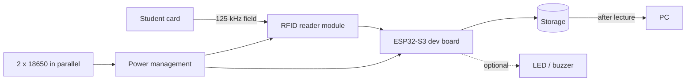

<h1 align="center">Smart Attendance System - by Ice</h1>

<p align="center">
  
</p>

<p align="center">
  <b>Embedded systems project - wireless card-tap attendance device for lecture halls</b>
</p>

<p align="center">
  <a href="#-about">About</a> &nbsp;·&nbsp;
  <a href="#-how-it-works">How It Works</a> &nbsp;·&nbsp;
  <a href="#-why-esp32-s3">Why ESP32-S3?</a> &nbsp;·&nbsp;
  <a href="#-key-features">Features</a> &nbsp;·&nbsp;
  <a href="#-why-a-125-khz-reader">Card Reader</a> &nbsp;·&nbsp;
  <a href="#-system-architecture">Architecture</a> &nbsp;·&nbsp;
  <a href="#-wiring">Wiring</a> &nbsp;·&nbsp;
  <a href="#-flashing">Flashing</a> &nbsp;·&nbsp;
  <a href="#-lessons-learned">Lessons</a> &nbsp;·&nbsp;
  <a href="#-roadmap">Roadmap</a>
</p>

---

<h2>📌 About</h2>

**Smart Attendance System** is a battery-powered, fully wireless attendance device built around an **ESP32-S3** and an **RFID card reader**. At the end of a lecture, the lecturer stands at the door and each student places their student card flat on the device. The device reads the card, timestamps the tap, and stores it. Afterwards the lecturer plugs the device into a PC to collect the attendance files.

The idea comes from a system students already know: the **university restaurant**, where the same student card is placed on a small reader (no laser, no pointing) that shows the student's details and ticks that they ate. This project brings the same tap-and-go interaction to lecture attendance.

The project is being built the professional way: documented requirements, a decisions log, a test plan, a KiCad-designed custom PCB, and a FreeCAD enclosure, with the whole thing planned to finish by **February 2027**.

> [!NOTE]
> Built for educational purposes as an embedded systems project. The project is under active development, so some sections below describe the planned design and are marked as such.

---

<h2>🔄 How It Works</h2>

1. The lecturer stands at the door at the end of the lecture.
2. Each student places their card flat on the reader.
3. The ESP32-S3 reads the card identifier, adds a timestamp and ignores repeat taps.
4. The record is saved to a file that survives power-off.
5. After the lecture, the lecturer plugs the device into a PC and retrieves the attendance files.

During the lecture the device needs **no cables at all**: it runs on batteries and the PC is only used afterwards.

---

<h2>🔬 Why ESP32-S3?</h2>

The ESP32-S3 gives a dual-core processor, built-in WiFi and Bluetooth, native USB and plenty of GPIO in a single dev board, so the reader, storage, feedback and power monitoring can all be handled without a second microcontroller.

For the final PCB, the **ESP32-S3 dev board is mounted on a footprint** instead of designing around the bare chip or module. A chip-level ESP32 design (antenna, flash, boot circuitry) would add a lot of risk for no real benefit in this project, so the custom board focuses on everything around the dev board: reader connection, power and the rest of the circuit.

---

<h2>⚡ Key Features</h2>

| | Feature | Detail | Status |
|---|---|---|---|
| 🧠 | **Platform** | ESP32-S3 dev board | Owned |
| 💳 | **Card reading** | 125 kHz RFID reader module, card placed flat | Bought, testing |
| 🔋 | **Power** | 2 × 18650 cells in parallel | Bought |
| 📶 | **Wireless in use** | Battery powered, no cables at the door | Design goal |
| 💾 | **Data storage** | Attendance file kept through power-off | Medium to be decided |
| 🖥️ | **PC access** | Plug into a PC afterwards to get the files | Method to be decided |
| 🔁 | **Duplicate protection** | A card tapped twice is counted once | Planned |
| 🔔 | **Tap feedback** | LED and/or buzzer on each tap | Planned (optional) |
| 🛠️ | **Custom PCB** | Designed in KiCad, ESP32-S3 board on a footprint | Planned |
| 📦 | **Enclosure** | Designed in FreeCAD | Planned |

---

<h2>💳 Why a 125 kHz Reader?</h2>

The student cards are RFID cards, but their frequency was not documented, and RFID cards come in two common families:

| Family | Frequency | Phone can read it? |
|---|---|---|
| Low frequency (LF) | 125 kHz | No |
| High frequency (HF / NFC) | 13.56 MHz | Yes |

The card was tested with two phones. An iPhone running NFC Tools detected nothing, and an Android phone did not detect the card either, while the same Android phone read a **passport** (a 13.56 MHz device) normally. Since phones can only read 13.56 MHz, this points to the student card being a **125 kHz** card.

Based on that, the decision was to **buy only the 125 kHz reader first**, rather than spending on both module types. The reader test on the breadboard is the real confirmation: if it does not read the card, the choice is reassessed and a 13.56 MHz module is considered.

> [!TIP]
> Decisions like this one are recorded with their reasons in [`documentation/decisions_log.md`](documentation/decisions_log.md).

---

<h2>🏗️ System Architecture</h2>



| Block | Function |
|---|---|
| RFID reader | Energizes the card and outputs its identifier |
| ESP32-S3 | Reads the reader, timestamps, stores, serves data to the PC |
| Storage | Keeps the attendance file |
| Power | Charging, protection and regulation of the 18650 pair |
| Feedback | Confirms each tap to the student |

Full details: [`documentation/system_architecture.md`](documentation/system_architecture.md)

---

<h2>🎯 Planned Device Behaviour</h2>

| State | Feedback | Trigger |
|---|---|---|
| 🟢 **READY** | Steady LED | Waiting for a card |
| 🔵 **CARD ACCEPTED** | Short beep / blink | New card read and saved |
| 🟡 **DUPLICATE** | Double beep / blink | Same card already recorded |
| 🔴 **ERROR** | Long beep / red | Read or storage failure |

This is the intended design for the feedback system, to be confirmed during firmware development.

---

<h2>🔌 Wiring</h2>

Breadboard wiring for the prototype is documented pin by pin in [`documentation/assembly_guide.md`](documentation/assembly_guide.md).

| Component | Pin | ESP32-S3 GPIO |
|---|---|---|
| RFID reader | VCC / GND | 5V or 3V3 (per reader datasheet) / GND |
| RFID reader | Data out | _to be filled once tested_ |
| Feedback LED | Anode | _to be filled_ |
| Buzzer | Positive | _to be filled_ |

**Power:** 2 × 18650 cells in parallel → power management → ESP32-S3 and reader.

> [!WARNING]
> Check the reader module's supply voltage and logic level in its datasheet before powering it. Never connect the battery pack directly to the ESP32-S3 pins, and never run USB and battery power into the board at the same time unless the board's power path is designed for it.

---

<h2>🚀 Flashing</h2>

Built and flashed with **VS Code + PlatformIO**.

```ini
[env:esp32-s3-devkitc-1]
platform = espressif32
board = esp32-s3-devkitc-1
framework = arduino
monitor_speed = 115200
```

The board name is an example: use the one that matches your dev board.

```bash
cd firmware
pio run               # build
pio run -t upload     # flash the ESP32-S3
pio device monitor    # serial monitor
```

<details>
<summary><b>Upload notes</b></summary>
<br>

- If upload fails with "Unable to verify flash chip connection", hold **BOOT** while it says `Connecting...`
- On Linux, if the port is not found: add your user to the `dialout` group, or temporarily use `sudo chmod 666 /dev/ttyACM0`
- Some ESP32-S3 boards have two USB ports (native USB and UART): try both if one is not detected

</details>

---

<h2>🧰 Tools</h2>

| Tool | Used for |
|---|---|
| PlatformIO | Firmware |
| KiCad | Schematic and PCB |
| FreeCAD | Enclosure |
| GNU Octave | Calculations and simulation (power budget, battery life) |

---

<h2>📁 Repository Structure</h2>

| Path | Content |
|---|---|
| `overview.md` | Problem, concept, architecture at a glance |
| `smart_attendance_system_index.md` | Map of every file and folder |
| `documentation/` | Requirements, architecture, BOM, assembly guide, test plan, project plan, decisions log |
| `firmware/` | PlatformIO project for the ESP32-S3 |
| `hardware/` | KiCad project, datasheets, enclosure, manufacturing files |
| `simulation/` | Octave scripts and calculations |
| `media/` | Photos, videos, diagrams |

---

<h2>🔧 Lessons Learned</h2>

Small hardware lessons from the prototype stage:

- **Breadboard wiring:** 40 pre-made Dupont jumper cables turned out too flexible and bulky for a tidy breadboard. Solid-core wire (0.6 mm / 22 AWG), cut to length, in red (power), black (ground) and green (signal), is much cleaner and more reliable.
- **Test before buying more:** only the 125 kHz reader was purchased at first, so a wrong guess about the card costs one module instead of two.
- **Keep the PCB scope realistic:** mounting the ESP32-S3 dev board on the PCB removes the hardest part of the board design.

---

<h2>⚠️ Limitations</h2>

- A 125 kHz card identifier is a plain number that can be copied, and a student could tap a friend's card. The system proves a **card** was tapped, not that the owner was present.
- Matching card numbers to student names needs a student list, which is not part of the first version.

---

<details>
<summary><b>Roadmap</b></summary>
<br>

- [x] Project concept and requirements
- [x] Prototype parts purchased
- [ ] Breadboard assembly
- [ ] First card read (confirms the 125 kHz choice)
- [ ] Firmware v1: read, timestamp, store, retrieve
- [ ] Decide storage medium and PC access method
- [ ] KiCad schematic
- [ ] PCB layout and manufacturing
- [ ] FreeCAD enclosure
- [ ] Full testing with the test plan
- [ ] Final documentation, photos and demo video (February 2027)

</details>

---

<h1 align="center">DISCLAIMER</h1>
<h4 align="center">This project is an educational embedded systems build. It records card taps only and is not a secure identity verification system.</h4>
