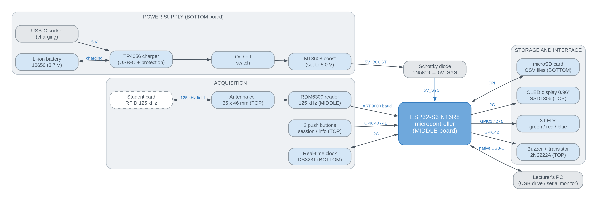
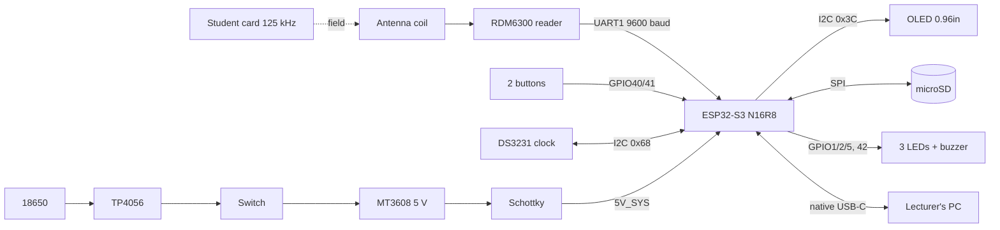

# System Architecture

## Blocks
| Block | Part | Function |
|---|---|---|
| Card reading | RDM6300 + 35 × 46 mm coil | Powers the card with a 125 kHz field, sends a 14-byte frame per read |
| Processing | ESP32-S3 N16R8 dev board | Checks the frame, looks up the student, time-stamps, stores, drives the feedback and the USB link |
| Time | DS3231 + CR2032 | Date and time, kept when the power is off |
| Storage | microSD (FAT32) | `students.csv`, one CSV per session, one sorted final list per session |
| Feedback | 3 LEDs, buzzer (2N2222A), OLED | Present, unknown, duplicate, error, session state |
| Controls | 2 push buttons | Button 1: start (short) / stop (long). Button 2: info (short) / USB drive (hold 3 s) |
| Power | 18650, TP4056, switch, MT3608, 1N5819 | USB-C charging, protection, 5 V rail; USB and battery share 5V_SYS through the diode |

## Power rails
| Rail | Voltage | Feeds |
|---|---|---|
| BAT+ / CHG_OUT+ / SW_OUT | 3.0–4.2 V | MT3608 input |
| 5V_BOOST | 5.0 V | Diode D101 (via cable 2 pins 1 and 3) |
| 5V_SYS | ≈ 4.7 V on battery, ≈ 5 V on USB | ESP32-S3 5V pin, RDM6300, microSD module, buzzer option |
| 3V3 | 3.3 V (ESP32 board regulator) | OLED, DS3231, LEDs, buzzer (default) |
| GND | TP4056 OUT− | Everything |

## Data flow
1. The lecturer starts a session (button 1 or `START`). A new file `/attendance/YYYYMMDD_hhmmss.csv` is opened.
2. A card enters the field; the RDM6300 sends its frame; the ESP32-S3 checks start/end bytes and the XOR checksum.
3. The UID is looked up in `/students.csv`. Already seen in this session → duplicate. Not in the list → unknown (and added to `students.csv` as an `UNKNOWN` line to fill in).
4. The time is read from the DS3231 and one line is appended to the session file.
5. LEDs, buzzer and OLED show the result.
6. A long press on button 1 ends the session and writes `/final/YYYYMMDD_hhmmss.txt`, sorted by surname, tab-separated.
7. Plugged into a PC on the native USB-C port, the microSD appears as a USB drive. After an eject, the firmware restarts to read the card cleanly.

## Physical layout
Three stacked 95 × 60 mm boards (TOP: interface and coil, MIDDLE: ESP32-S3 and RDM6300, BOTTOM: power, microSD, clock), joined by two 16-wire ribbon cables. Pinouts: [`hardware/schematics/kicad/sas_pcb/documentation/Connector_Table.md`](../hardware/schematics/kicad/sas_pcb/documentation/Connector_Table.md).

Firmware flowcharts: `media/diagrams/flowchart_*.png`.
