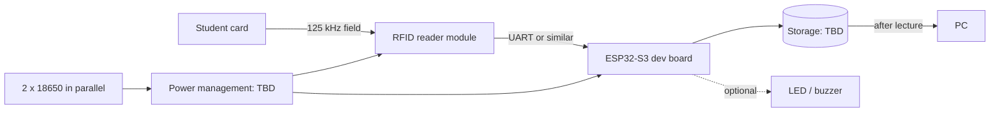

# System Architecture

## Blocks
| Block | Function | Status |
|---|---|---|
| RFID reader | Energizes the card and outputs its identifier | Purchased, to be tested |
| ESP32-S3 | Reads the reader, timestamps, stores, serves data to the PC | Owned |
| Storage | Keeps the attendance file | To decide |
| Power | Charging, protection and regulation of the 18650 pair | To decide |
| Feedback | Confirms each tap to the student | Optional |

## Data flow
1. Card enters the reader field and the reader outputs its identifier.
2. The ESP32-S3 reads it, adds the time, checks for duplicates.
3. The record is written to storage.
4. After the lecture the data is transferred to the PC.

## Final PCB
The ESP32-S3 dev board is mounted on the PCB through a footprint (no chip-level ESP32 design). Other parts can go on the board as chips where this stays simple.
